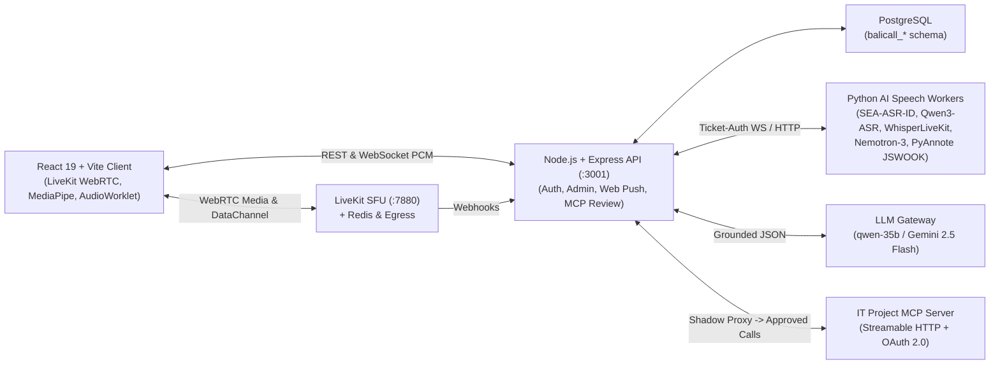
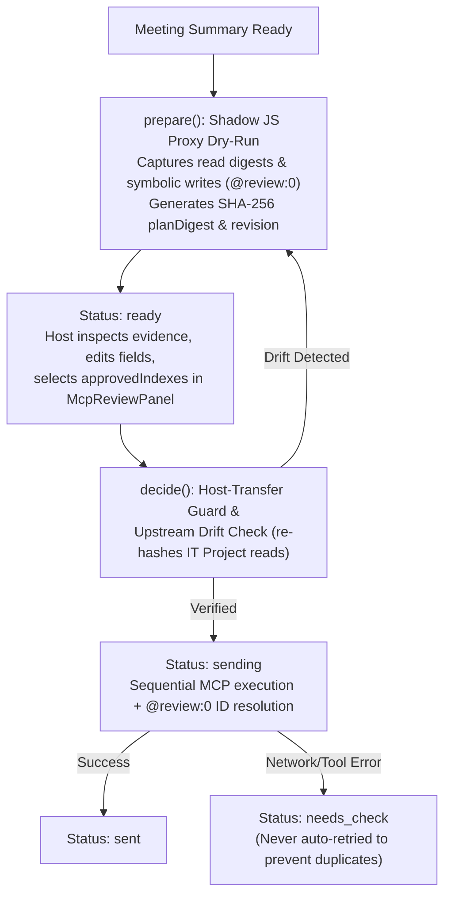

# BaliCall — Presentation Outline & Technical Demo Guide

This document provides a structured presentation outline, core technology deep-dive, and step-by-step live technical demo rundown for **BaliCall** (Bali Tower Sentra's enterprise video-conferencing, diarized transcription, grounded AI summarization, and MCP task-execution platform).

---

## 1. Presentation Outline (Slide-by-Slide)

### Slide 1: Title & Executive Overview
- **Project:** BaliCall — Enterprise Video Conferencing & AI Meeting Execution Platform
- **Problem Statement:** Traditional video meetings lose context between live discussion, meeting minutes, and project management tracking. Manual note-taking misses technical terms, cannot reliably attribute speakers in shared conference rooms, and risks hallucinated or unverified action items.
- **Solution:** A unified platform combining **LiveKit WebRTC**, **Indonesian-capable live ASR & speaker diarization**, **verbatim-grounded LLM summarization**, and **Human-in-the-Loop Model Context Protocol (MCP)** integration with IT Project.

---

### Slide 2: High-Level System Architecture

---

### Slide 3: Core Technology Stack

| Layer | Technologies & Libraries | Key Responsibilities |
| :--- | :--- | :--- |
| **Frontend** | React 19 (`^19.2.8`), TypeScript (`~6.0.2`), Vite 8 (`^8.3.0`), `lucide-react`, `react-zoom-pan-pinch` | Workspace UI, Pre-Join diagnostics, In-Call stage, Transcript & MCP Review panels, Admin Dashboard |
| **WebRTC & Client AI** | `livekit-client` (`^2.22.3`), `@livekit/components-react`, `@livekit/track-processors`, `@mediapipe/tasks-vision` | SFU media transport, Simulcast/Dynacast, DataChannel sync, WebGL/WASM background blur & virtual backgrounds |
| **Audio Capture** | Web Audio `AudioWorkletProcessor` (`live-pcm-worklet.js`), `MediaRecorder` VAD, Web Speech API | 16 kHz mono Int16 PCM resampling, 700 ms silence-split fallback, domain-boosted browser STT |
| **Backend API** | Node.js `>=22.18.0` (ESM), Express (`^4.21.2`), `pg` (`^8.23.1`), `livekit-server-sdk`, `web-push`, `pdfkit`, `multer`, `sharp` | Auth/CSRF, LiveKit token & webhook handling, WebSocket STT proxy, VAPID push reminders, PDF export |
| **Speech & Diarization** | Python workers (`faster-whisper`, `sea_asr`, `qwen_asr`/vLLM, `transformers`, `pyannote.audio`, `webrtcvad`) | Live streaming ASR, streaming & batch speaker diarization, word-to-turn temporal alignment |
| **AI & Integration** | `@modelcontextprotocol/sdk` (`^1.32.2`), `@google/genai` (`^2.26.0`), Office `qwen-35b` gateway | Grounded `grounded-v12` summarization, verbatim evidence verification, 21-tool IT Project MCP execution |

---

### Slide 4: Real-Time Video, Media & UX Engineering
- **Adaptive WebRTC (`client/src/InCallView.tsx`, `MeetingRoom.tsx`):**
  - `dynacast: true` & `simulcast: true`: Video layers are published only when subscribers demand them.
  - **Screen Share Stage (`ScreenShareStage.tsx`):** 1×–5× pan-and-zoom canvas (`react-zoom-pan-pinch`) with adaptive resolution ceilings (`360p` to `4k`/`original`) negotiated over LiveKit DataChannel (`screen_share_res`).
  - **Speaker Spotlight Debouncing (`speakerSpotlight.ts`):** `SPEAKER_SETTLE_MS = 600` and `SPEAKER_HOLD_MS = 1200` prevent tile jumping from brief noises.
  - **Shared Room Mic Mode (`sharedRoomMic`):** Disables browser Auto Gain Control (`autoGainControl: false`) to prevent volume pumping and clipping during rapid multi-speaker conference room discussions.
- **Client-Side AI Video Effects (`client/src/backgroundEffects.ts`):**
  - Uses `@mediapipe/tasks-vision` via `@livekit/track-processors` for browser-side segmentation (blur `blurRadius: 15` or custom images up to 5 MB / 4096×4096 px).
  - `shouldMirrorCamera` mirrors plain/blurred local feeds while keeping custom virtual backgrounds unmirrored so corporate logos and text remain legible.

---

### Slide 5: Audio Pipeline, ASR & Speaker Diarization
- **Client Audio Pipeline (`client/public/live-pcm-worklet.js`, `client/src/liveTranscription.ts`):**
  - Custom `LivePCM` `AudioWorkletProcessor` downsamples microphone input to **16 kHz mono 16-bit signed PCM** (32 KB/s) and streams **100–200 ms** frames over WebSocket with backpressure protection (`bufferedAmount > 160000`).
  - **Real-Time Transcript Sync (`transcriptDelivery.ts`):** Publishes lightweight LiveKit DataChannel notices (`balicall.transcript.saved.v1`) without raw text/tokens so peers fetch authoritative state from PostgreSQL.
- **Multi-Model Speech & Diarization Workers (`server/speech/`):**
  - **SEA-ASR-ID Live (`sea_live_app.py`, `sea_diarization.py`):** CPU-optimized Indonesian streaming ASR with a 12 s rolling window, 0.8 s silence endpointing, and `WordAttributor`.
  - **Qwen3-ASR (`qwen_live_app.py`, `qwen_gguf_live_app.py`):** `Qwen/Qwen3-ASR-0.6B` (vLLM and 8-bit GGUF quantized).
  - **WhisperLiveKit & Batch Whisper (`live_app.py`, `app.py`):** `faster-whisper` streaming (`localagreement`) and batch transcription.
  - **Nemotron-3 Streaming Diarization (`nemotron_live_engine.py`, `nemotron_app.py`):** `nvidia/Nemotron-3-Diarization` in `low_latency` mode with stateful `speaker_cache` and sigmoid overlap detection (`> 0.5`), classifying turns as `Pembicara {N}` (`assigned`), `Suara bertumpuk` (`overlap`), or `Pembicara belum diketahui` (`unknown`).
  - **PyAnnote JSWOOK (`pyannote_jswook_app.py`):** `pyannote/speaker-diarization-community-1` injected with fine-tuned `JSWOOK/pyannote_2_finetuning` segmentation weights + `faster-whisper`.
- **Temporal Word-to-Turn Alignment (`server/speech/alignment.py`):**
  - `align_words(words, turns)` assigns each word to the speaker turn with maximum temporal intersection:
    $$\text{overlap} = \max\bigl(0,\ \min(\text{end}, \text{stop}) - \max(\text{start}, \text{begin})\bigr)$$

---

### Slide 6: Grounded LLM Summarization & Anti-Hallucination
- **Multi-Provider Routing (`server/providers.js`):**
  - `office` (default): Internal OpenAI-compatible gateway (`qwen-35b`, `temperature: 0`, exponential backoff + retry budget up to 120 s).
  - `gemini`: `@google/genai` (`gemini-2.5-flash`) with structured JSON schema output.
  - `demo`: Deterministic offline fallback.
- **Orthographic Domain Normalization:**
  - Regex post-processing (`ORTHOGRAPHIC_CORRECTIONS` in `server/providers.js` & `client/src/speechRecognition.ts`) corrects ASR mishearings of domain terms (`Bali Tower`, `LiveKit`, `WebRTC`, `Grad-CAM`, `DINOv2`, `YOLOv12s`, `RF-DETR Seg`, `Focal Loss`, `RapidOCR`).
- **Anti-Hallucination Engine (`server/summaryGrounding.js`, `SUMMARY_VERSION = 'grounded-v12'`):**
  - Indexes every utterance (`U0001`, `U0002`, ...) with a SHA-256 transcript digest.
  - `validateSummaryEvidence` enforces:
    1. **Verbatim Quote Check:** Every `quote` must be an exact substring of its referenced `utteranceId`.
    2. **Numeric & Unit Fidelity:** Validates numbers, multipliers (`ribu`, `juta`, `miliar`), and currencies (`Rp`, `USD`, `EUR`).
    3. **Negation & Uncertainty Guard:** Prevents rejected/pending items (`belum`, `tidak`, `ditolak`, `pending`) from being turned into confirmed decisions.
    4. **Condition Preservation:** Retains qualifying clauses (e.g., `"tanpa gangguan layanan"`).
  - **UI Traceability (`SummaryEvidence.tsx`):** Users can expand evidence drawers to inspect exact verbatim quotes behind each summary point.

---

### Slide 7: Model Context Protocol (MCP) & Human-in-the-Loop Safety
- **Transport & Tooling (`server/itproject/client.js`):**
  - Uses `@modelcontextprotocol/sdk` (`StreamableHTTPClientTransport`) + OAuth 2.0 auto-refresh (`data/itproject-oauth.json`) to access **21 IT Project tools** (`create-project`, `create-task`, `update-task-status`, `update-task`, `create-sprint`, `assign-sprint-tasks`, `start-sprint`, `complete-sprint`, etc.).
- **Two-Phase Commit & Cryptographic Safety (`server/mcpReview.js`, `client/src/McpReviewPanel.tsx`):**

- **Key Safety Guarantees:**
  - **Strict Host Authority:** Only the active `meeting.hostId` can approve; if host ownership transfers mid-review, execution aborts (`403`).
  - **Upstream Drift Guard:** Re-verifies IT Project state digests right before writing so stale plans cannot overwrite external changes.
  - **Idempotency:** Failed mid-flight calls lock into `needs_check` instead of auto-retrying, preventing duplicate tasks or sprints.

---

### Slide 8: Enterprise Auth, Admin Operations & Scheduling
- **Authentication (`server/auth.js`, `client/src/AuthGate.tsx`):**
  - `scrypt` password hashing, HTTP-only session cookies + CSRF validation, single-session concurrency detection (`409 ACCOUNT_ALREADY_LOGGED_IN` takeover modal), guest invite codes, and self-service **Request Aktivasi**.
- **Admin Dashboard (`client/src/AdminDashboard.tsx`, `server/adminApi.js`):**
  - 7 modules: `Overview`, `Karyawan`, `Permintaan` (activation request cards with search & `Terima`/`Tolak`), `Rapat` (live & historical), `Unggahan` (offline recordings), `Layanan` (real-time health of PostgreSQL, LiveKit, LLM, and ASR/diarization workers), and `Audit` (immutable trail).
- **Scheduling & Web Push (`server/notifications.js`, `client/public/notifications-sw.js`):**
  - Deterministic 5-character room codes (FNV-1a hash) and a 30 s background ticker sending VAPID Web Push reminders 10 minutes before scheduled meetings and when AI summaries are ready.

---

## 2. Live Technical Demo Rundown (15–20 Minutes)

### Pre-Demo Checklist
1. Launch services via `start.bat` (LiveKit SFU `:7880`, Express API `:3001`, Vite Client `:5187`, speech workers, and PostgreSQL).
2. Log in as Super Admin and open **Admin → Layanan** to verify all required services (PostgreSQL, LiveKit, LLM, ASR/diarization workers) show ready status.
3. Have a short sample `.wav`/`.mp4` meeting recording ready as a backup for **Unggahan Rekaman** (`RecordingUploadView.tsx`).

---

### Demo Walkthrough

#### Step 1: Onboarding, Auth & Admin Operations (2–3 min)
1. **Show Login Screen (`AuthGate.tsx`):**
   - Highlight the 4 access modes: Employee Login, **Aktivasi akun**, **Request Aktivasi**, and **Gabung sebagai tamu**.
   - Submit a test **Request Aktivasi** (Name, Email, 8+ char password) to show self-service onboarding.
2. **Show Admin Dashboard (`AdminDashboard.tsx`):**
   - Log in as Super Admin → open **Permintaan**, search for the applicant by name/email, and click **Terima** (activating the account immediately) or **Tolak**.
   - Briefly show **Layanan** (live worker health) and **Audit** (recorded `account.request.approve` trail).

#### Step 2: Pre-Join Diagnostics & Client-Side MediaPipe AI (3 min)
1. Join a scheduled room or enter a 5-character room code.
2. On **Pre-Join (`PreJoinPreview.tsx`)**:
   - Show microphone level diagnostics (`MicrophoneDiagnostic`).
   - Toggle **Blur / Virtual Background** (`backgroundEffects.ts` / `@mediapipe/tasks-vision`) and note that custom backgrounds stay unmirrored so text/logos remain readable.
   - Highlight **Mode Mikrofon Ruang Rapat (`sharedRoomMic`)** and live/batch diarization toggles, explaining how it disables browser AGC and enables multi-speaker attribution.

#### Step 3: Live Call, Screen Share & Real-Time Diarized Transcription (5 min)
1. **In-Call Stage (`InCallView.tsx`, `MeetingRoom.tsx`):**
   - Demonstrate Grid vs. Speaker Spotlight (`speakerSpotlight.ts` debouncing) and **Share Screen** (`ScreenShareStage.tsx` pan/zoom + resolution selector).
2. **Live Transcription & Diarization (`liveTranscription.ts`, `TranscriptRealtimeBridge.tsx`):**
   - Open the **Transkrip** panel and speak 2–3 structured sentences mentioning a project, task, priority, and technical terms (e.g., *"Bali Tower"*, *"LiveKit"*).
   - Point out streaming interim → final utterances and speaker labels (`Pembicara 1`, `Pembicara 2`, or `Suara bertumpuk` on overlapping speech).
   - Rename a speaker via `SpeakerNameEditor.tsx` and explain that LiveKit DataChannel broadcasts a lightweight sync notice to all participants.

#### Step 4: Grounded AI Summary & Evidence Verification (3–4 min)
1. Click **Selesai & notulen** to end the meeting and generate the summary.
2. In **Summary History (`SummaryHistoryView.tsx`)**:
   - Show the structured Executive Summary, Decisions, and Action Items.
   - Expand an **Evidence** drawer (`SummaryEvidence.tsx`) to show the **exact verbatim transcript quote (`U000x`)** verifying the AI claim.
   - *(Optional)* Show **Unggahan Rekaman (`RecordingUploadView.tsx`)** to demonstrate offline batch `transcribing → diarizing → summarizing` and re-summarization.

#### Step 5: MCP Human-in-the-Loop Execution (4–5 min)
1. Open the **MCP Review Panel (`McpReviewPanel.tsx`)** for the finished meeting.
2. Point out the proposed IT Project actions (`create-task`, `update-task-status`, `create-sprint`, etc.) linked to transcript evidence quotes.
3. Edit a proposed task field inline (e.g., title, priority, or assignee) and select/deselect specific actions (`approvedIndexes`).
4. Explain the **Shadow Proxy `planDigest`** and **Upstream Drift Guard**, then click **Setujui** to execute the approved MCP tool calls via `StreamableHTTPClientTransport` into IT Project (`ready → sending → sent`).

---

### Demo Contingency Plan
- **IT Project MCP / OAuth unreachable:** Show the **MCP Review Panel** in `ready` state (generated by `prepare()`) to demonstrate shadow dry-run planning, evidence linking, inline editing, and explain the `needs_check` idempotency guard.
- **Speech Worker offline:** Switch transcription mode in Pre-Join to **Browser** (`speechRecognition.ts` with domain-term boosting) or demo **Unggahan Rekaman** / **Summary History** with seeded data.
